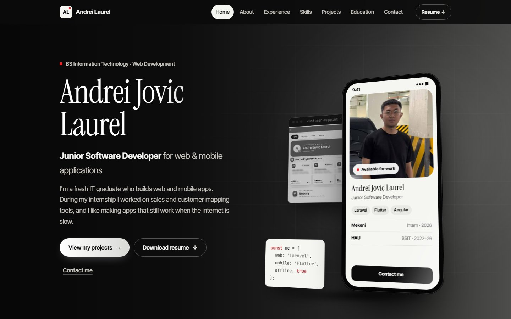

# Andrei Jovic Laurel | Portfolio

This is my personal portfolio. I'm a fresh BS Information Technology graduate from Holy Angel University, majoring in Web Development, and I build web and mobile applications.

**Live site** https://laurelportfolio.netlify.app/



## What's inside

| Section | What you'll find |
| --- | --- |
| **Home** | A short introduction and a 3D web and mobile scene with my profile |
| **About** | My background and my journey from school to my internship |
| **Experience** | Software Development Intern at the Mekeni ICT Department (Aug to Nov 2026) |
| **Skills** | The languages, frameworks and tools I have used |
| **Projects** | Mekeni Sales, Customer Mapping, MedFind and Owens Bakery |
| **Education** | My degree and certifications |
| **Contact** | My contact details and a message form |

## Featured projects

- **Mekeni Sales** is a Flutter mobile app with a company app dashboard, sales orders that work offline and sync later, and an Employee Portal. I worked on it with the Mekeni ICT team.
- **Customer Mapping** is a Laravel and AngularJS web tool for customer outlets, map pins, visit plans and sales monitoring. I worked on it with the Mekeni ICT team.
- **MedFind** is a pharmacy system with a medicine finder, inventory, POS and IndexedDB offline sync. I was the front-end developer and main debugger. [Visit the live site](https://www.motherandchildpharmacy.com/)
- **Owens Bakery Shop** is a WordPress business website where I handled the pages, SEO and analytics.

## Built with

- HTML, CSS and plain JavaScript with no framework or build step
- CSS 3D transforms for the home scene, card tilt and scroll effects
- [Formspree](https://formspree.io/) for the contact form
- Google Fonts (Instrument Serif, Inter Tight and JetBrains Mono)

The site works on phones, tablets and desktops, and it respects the reduce motion setting.

## Run it locally

Open `index.html` in a browser, or serve the folder with any static server.

```bash
npx serve .
```

## Project structure

```
index.html            Page content
assets/styles.css     Styles
assets/main.js        Navigation, 3D effects, screenshot tabs and contact form
cv/                   Resume (PDF)
images/profile/       Profile photos
images/projects/      Project screenshots, one folder per project
docs/                 Images used in this README
```

## Contact

- Email at [andrei.laurel.3@gmail.com](mailto:andrei.laurel.3@gmail.com)
- GitHub at [@diastimaa](https://github.com/diastimaa)
